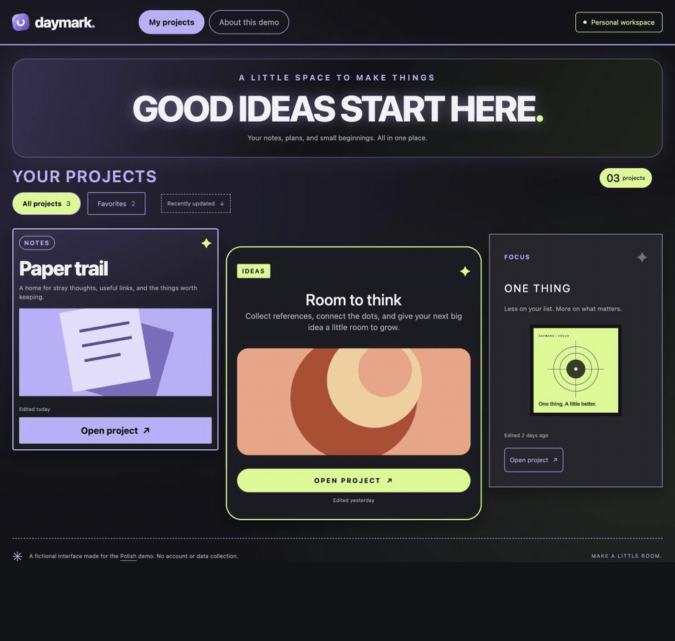

# Polish

**Improve the interface. Keep its identity.**

A reusable Agent Skill for finishing existing websites and app interfaces. Polish helps an AI coding assistant find and fix uneven spacing, weak hierarchy, inconsistent components, awkward copy, misframed media, and motion that does not match the interaction.

It starts with the project's approved brand and design system. A colorful logo, bold heading, or animated preview can be intentional. The goal is to make those choices work well together.

## See a real pass

Actual browser captures of a Polish pass on **Daymark**, a fictional starter with deliberately uneven spacing. The logo, palette, artwork, copy, and interactions stay the same; the layout CSS changes.

[](examples/daymark/README.md)

The GIF plays once in under five seconds. View the [static before](docs/media/before-desktop.jpg) and [static after](docs/media/after-desktop.jpg), or inspect the [source, mobile captures, and measured checks](examples/daymark/README.md).

## Use it

```text
$polish the product grid. Align the media and action links, preserve the
artwork and copy, and check the narrow and wide layouts.
```

```text
$polish this dashboard. Improve spacing and hierarchy using the existing
components, colors, and typography.
```

```text
$polish audit only: review this page and rank the visible problems.
```

The skill distinguishes an audit, a focused repair, and a broader finishing pass. For an edit request, it proceeds with the authorized work and verifies the result. It asks for input when a material decision or missing access actually requires it.

## What it covers

| Area | Typical work |
| --- | --- |
| Layout | Consistent gaps, aligned actions, responsive content growth, overflow repairs |
| Copy and type | Clearer labels, readable hierarchy, better wrapping, preserved product facts |
| Components | Consistent buttons, icons, states, focus, and hit areas |
| Media | Correct aspect ratios, complete artwork, reserved space, usable fallbacks |
| Motion | Feedback tied to an action, synchronized reveals, reduced-motion behavior |
| Delivery | Scoped source edits, relevant checks, honest distinction between local and live results |

Polish does not impose a house palette, typeface, spacing scale, or ban on visual effects. It reuses what the project already does deliberately and repairs what the evidence shows is broken. See the [example requests and expected behavior](examples/scenarios.md).

## Install in Codex

Copy the entire [`skills/polish`](skills/polish) directory into your personal skills directory:

```sh
git clone https://github.com/skwritesstuff/polish.git
mkdir -p ~/.agents/skills
cp -R ./polish/skills/polish ~/.agents/skills/polish
```

Run those commands only when `~/.agents/skills/polish` does not already exist; for an existing installation, compare it with the new version and preserve any local customizations before replacing it. For a project-only installation, use `.agents/skills/polish` inside that project instead.

Invoke it with `$polish`, or ask for a UI polish task that matches its description. If your client has not detected the new skill, restart the client. The package includes Codex display metadata in [`agents/openai.yaml`](skills/polish/agents/openai.yaml).

The core is an instruction-only `SKILL.md` package. It requires no API key, Node package, or bundled browser runtime. Your assistant still needs the file, browser, app, or CMS access required for the requested work. See the [Codex skills documentation](https://developers.openai.com/codex/skills/) for client-specific setup.

### Other Agent Skills clients

Use the same `skills/polish` folder in a client that supports the Agent Skills format, following that client's installation and invocation instructions. The core does not call a Claude or OpenAI API. Tool names and permissions come from the host.

This package has been validated as a Codex skill. Runtime behavior across other clients has not been independently tested.

## How it works

1. **Understand the scope.** Read the request, project instructions, and existing design decisions.
2. **Inspect the real screen.** Find the source and collect evidence at relevant widths and states.
3. **Choose the fixes.** Prioritize behavior and readability, then layout and visual details.
4. **Implement narrowly.** Reuse the current stack and design system; preserve approved content and assets.
5. **Verify and report.** Compare the rendered result, exercise affected controls, and state exactly what was checked and delivered.

For CMS work, the skill uses the editable page source and the available authorized tools. It preserves unrelated blocks and metadata, then checks the public page after an authorized publication. A local recreation is labeled as a recreation.

For screenshots, the skill can review visible issues immediately. Implementing the change requires access to the real project or an explicitly requested recreation.

## Give it your project's constraints

An optional `POLISH.md` in your project root can identify approved logos, colors, type, media ratios, motion, and content that must be preserved. Use the [project profile template](skills/polish/references/project-profile.md), or point the assistant to your existing design system.

Project-specific decisions stay in the project. The shared skill stays useful across brands, frameworks, and visual styles.

## Contributing

Issues and pull requests are welcome. Include a concrete UI problem, the expected behavior, and a small example or screenshot you have permission to share. For instruction changes, explain how they improve a real polishing task while preserving the project's intent.

Useful contributions include clearer workflows, edge cases, accessibility checks, CMS guidance, and evidence from other Agent Skills clients. Keep the core independent of a particular tool provider or visual trend.

## Credit and license

Polish is adapted from [Unslop](https://github.com/heydamir/unslop) by **Damir Sokolovsky** ([@heydamir](https://x.com/heydamir)). His work established the foundation for a structured UI finishing pass. This adaptation emphasizes existing brand decisions, scoped repairs, host-provided tools, purposeful motion, and verifiable delivery.

Distributed under [Creative Commons Attribution 4.0 International](LICENSE). The [attribution notice](NOTICE.md) records the source revision and changes. Keep the attribution and indicate your changes when sharing an adaptation.
