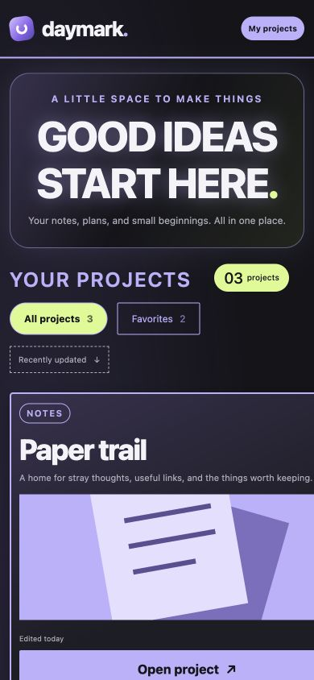
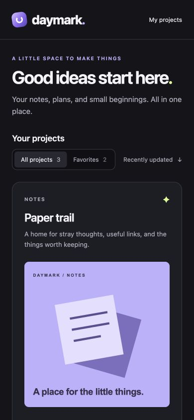

# Daymark: from rough prototype to polished interface

Daymark is a fictional workspace made specifically for this example. Its starter deliberately combines oversized headings, competing button styles, mismatched cards, cropped illustrations, and mobile overflow. It is not a production app or an independent benchmark.

The before and after images are actual, unretouched browser captures of the included source. The GIF adds labels below those captures and switches from before to after. The starter's defects were expanded for this revision to make the contrast more visible; the finished design is unchanged. This is a constructed demonstration, not a recording of an agent writing code.

## The request

```text
$polish the whole workspace. Establish a clear heading hierarchy, unify
controls and card styles, show the complete square artwork, and fix the
mobile overflow. Keep the approved brand, all copy, artwork, links, and
behavior intact.
```

The [project profile](POLISH.md) sets the constraints. The pass followed the Polish skill's scope, audit, narrow implementation, and rendered verification workflow.

## Before and after

| Before | After |
| --- | --- |
| Competing headings, three unrelated card styles, cropped artwork, and drifting actions. | Clear hierarchy, a shared component style, complete illustrations, and aligned actions. |
| [](../../docs/media/before-desktop.jpg?revision=2) | [](../../docs/media/after-desktop.jpg) |
| [Starter HTML](before.html) · [Starter CSS](before.css) | [Polished HTML](after.html) · [Polished CSS](after.css) |

Both desktop captures use a **1200 × 1000** browser viewport with all three projects visible.

The mobile comparison uses matching **390 × 844** viewports. The starter's 440px cards spill off the screen; the polished cards fit the available width.

| Before on mobile | After on mobile |
| --- | --- |
| [](../../docs/media/before-mobile-viewport.jpg) | [](../../docs/media/after-mobile-viewport.jpg) |

Full-page captures: [before](../../docs/media/before-mobile.jpg?revision=2) and [after](../../docs/media/after-mobile.jpg). The before capture includes the content outside the viewport; the matching viewport images above show the visible clipping.

## What changed

Measured in the desktop browser:

| Check | Before | After |
| --- | --- | --- |
| Card title sizes | 36px / 28px / 19px | 23px for each card |
| Card padding | 10px / 28px 18px / 26px | 24px for each card |
| Preview dimensions | 342.38 × 156px / 415.09 × 190px / 162.90 × 162.90px | 302 × 302px for each preview |
| Artwork framing | First two illustrations cropped; third undersized | All three complete and equally sized |
| Preview top positions | 548.27px / 619.47px / 577.32px | 494.77px for each preview |
| Action top positions | 722.27px / 833.47px / 769.22px | 812.77px for each action |
| Mobile document width at 390px | 452px: 62px of horizontal overflow | 390px: no horizontal overflow |

The polished stylesheet uses the existing typeface, spacing tokens, and base components. It replaces the competing emphasis and one-off card treatments with a clear heading hierarchy and consistent controls. `margin-top: auto` aligns the artwork and action rows while letting descriptions grow. The approved square images fill their content width without cropping, and the narrow grid fits the screen without hiding overflow.

## What stayed the same

The two HTML files differ only in their layout stylesheet link. Both use the same [base styles](shared.css), [interaction code](app.js), and [three SVG illustrations](assets). Project names, descriptions, metadata, links, button labels, and section order are identical.

The pass preserved the violet gradient mark, dark surfaces, lime accent, and colorful illustrations. It added no dependencies, network requests, or generated replacement artwork.

## Checks performed

- Rendered and inspected the desktop and narrow layouts, including the full mobile page.
- Measured the preview and action alignment from the rendered DOM.
- Exercised favorite filtering: two projects appeared, and returning to All projects restored three.
- Opened a project preview, dismissed it with Escape, and confirmed focus returned to the originating button.
- Checked the browser console for errors and verified content/artwork preservation against the baseline.
- Validated and rendered the labeled comparison with Cirro, decoded both final formats, and inspected frames before and after the transition.

These are browser viewport checks, not physical-device testing or a complete accessibility audit. This example demonstrates layout and media refinement; it does not test the skill's motion-editing, CMS, or native-app workflows.

## Try it locally

Open `before.html` and `after.html` in your browser. Alternatively, from this repository's root:

```sh
python3 -m http.server 8790 --bind 127.0.0.1
```

Then visit:

- `http://127.0.0.1:8790/examples/daymark/before.html`
- `http://127.0.0.1:8790/examples/daymark/after.html`

To try your own pass, copy the starter and ask your assistant to follow `POLISH.md`. Results will vary with the model, tools, and interpretation. Keep the original for a fair comparison.

## Media provenance

The SVG illustrations are original sample assets created for this repository. Captures contain no private application code, customer data, or third-party website content. The animated comparison is 960 × 912, lasts about 4.83 seconds, and plays once. Static alternatives are linked above.

The [verification record](verification.json) includes the observed measurements and source/media hashes. The example is covered by the repository's CC BY 4.0 license.
