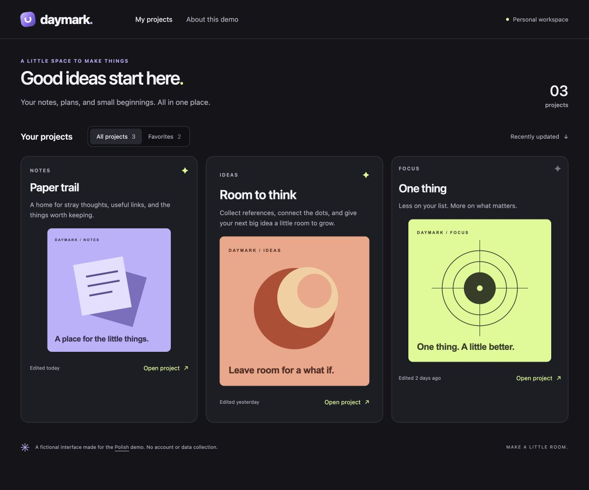
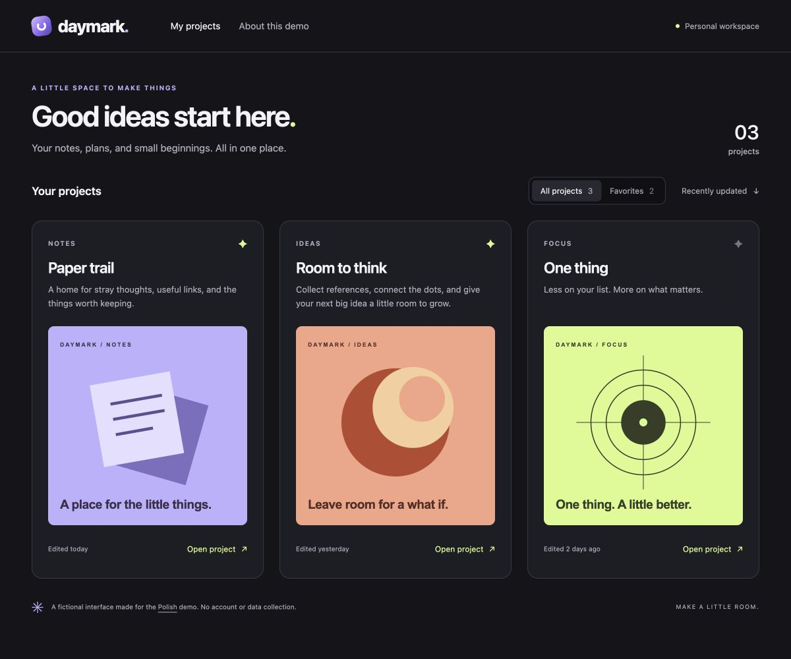

# Daymark: a real polish pass on a demo fixture

Daymark is a fictional workspace made specifically for this example. Its starter has deliberately inconsistent card padding, preview sizes, and action placement. It is not a production app or an independent benchmark.

The before and after images are actual, unretouched browser captures of the included source. The GIF adds labels below those captures and switches from before to after. It shows the result of a real editing pass, not a recording of an agent writing code.

## The request

```text
$polish the project grid. Fix inconsistent padding, uneven preview sizes,
and misaligned action rows. Improve the toolbar and title hierarchy using
the existing identity. Keep all copy, artwork, links, and behavior intact.
```

The [project profile](POLISH.md) sets the constraints. The pass followed the Polish skill's scope, audit, narrow implementation, and rendered verification workflow.

## Before and after

| Before | After |
| --- | --- |
| Different card padding, preview widths, and action positions. | Consistent padding, complete square artwork, and aligned action rows. |
| [](../../docs/media/before-desktop.jpg) | [](../../docs/media/after-desktop.jpg) |
| [Starter HTML](before.html) · [Starter CSS](before.css) | [Polished HTML](after.html) · [Polished CSS](after.css) |

Both desktop captures use a **1200 × 1000** browser viewport with all three projects visible. The single-column layout was also checked at **390 × 844**: [before mobile](../../docs/media/before-mobile.jpg) and [after mobile](../../docs/media/after-mobile.jpg) are full-page captures at that width.

## What changed

Measured in the desktop browser:

| Check | Before | After |
| --- | --- | --- |
| Card padding | 18px / 27px / 14px | 24px for each card |
| Square preview widths | 251.67px / 304.66px / 290.98px | 302px for each preview |
| Preview top positions | 466.15px / 482.65px / 447.35px | 494.77px for each preview |
| Action top positions | 736.82px / 806.31px / 757.34px | 812.77px for each action |
| Mobile horizontal overflow | None at the tested width | None at the tested width |

The fix uses shared spacing tokens and flex layout. `margin-top: auto` aligns the artwork and action rows while letting descriptions grow. The approved square images fill their content width without cropping. The toolbar groups its controls consistently, and the title uses a clearer weight and size within the same typeface.

## What stayed the same

The two HTML files differ only in their layout stylesheet link. Both use the same [base styles](shared.css), [interaction code](app.js), and [three SVG illustrations](assets). Project names, descriptions, metadata, links, button labels, and section order are identical.

The pass preserved the violet gradient mark, dark surfaces, lime accent, and colorful illustrations. It added no dependencies, network requests, or generated replacement artwork.

## Checks performed

- Rendered and inspected the desktop and narrow layouts, including the full mobile page.
- Measured the preview and action alignment from the rendered DOM.
- Exercised favorite filtering: two projects appeared, and returning to All projects restored three.
- Opened a project preview, dismissed it with Escape, and confirmed focus returned to the originating button.
- Checked the browser console for errors and verified content/artwork preservation against the baseline.
- Validated and rendered the labeled comparison with Cirro, decoded both final formats, and inspected frames before and after the transition.

These are browser viewport checks, not physical-device testing or a complete accessibility audit. This example demonstrates layout and media refinement; it does not test the skill's motion-editing, CMS, or native-app workflows.

## Try it locally

Open `before.html` and `after.html` in your browser. Alternatively, from this repository's root:

```sh
python3 -m http.server 8790 --bind 127.0.0.1
```

Then visit:

- `http://127.0.0.1:8790/examples/daymark/before.html`
- `http://127.0.0.1:8790/examples/daymark/after.html`

To try your own pass, copy the starter and ask your assistant to follow `POLISH.md`. Results will vary with the model, tools, and interpretation. Keep the original for a fair comparison.

## Media provenance

The SVG illustrations are original sample assets created for this repository. Captures contain no private application code, customer data, or third-party website content. The animated comparison is 960 × 864, lasts about 4.83 seconds, and plays once. Static alternatives are linked above.

The [verification record](verification.json) includes the observed measurements and source/media hashes. The example is covered by the repository's CC BY 4.0 license.
